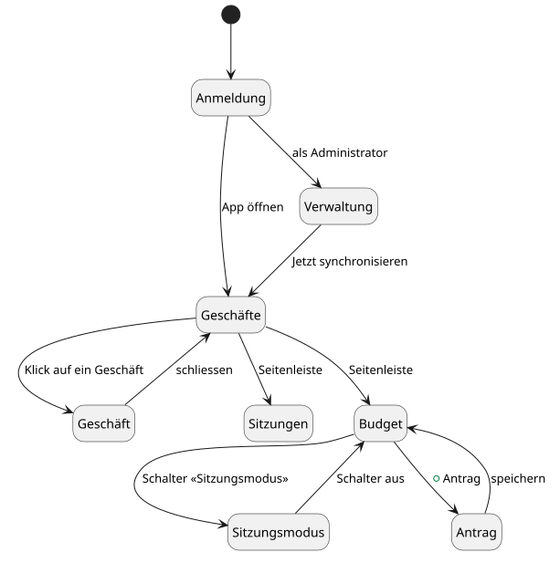
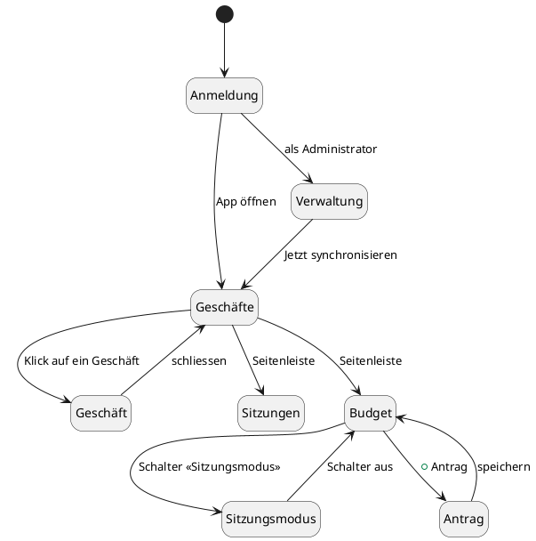
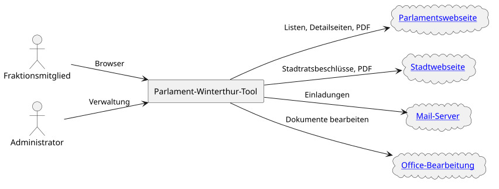
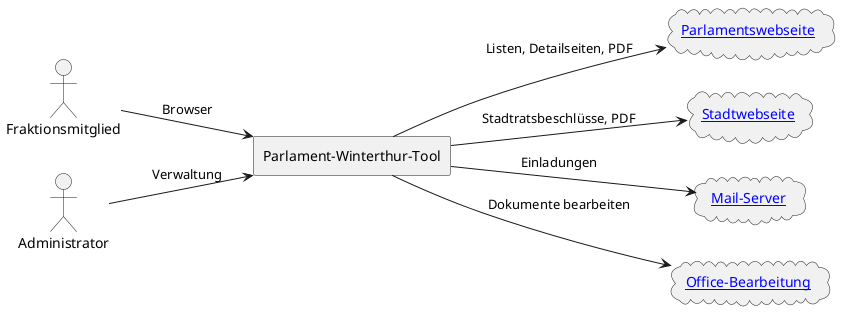
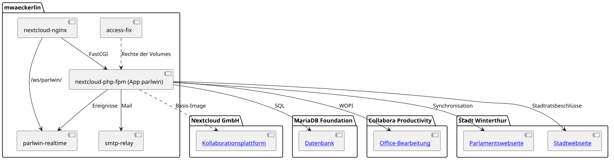
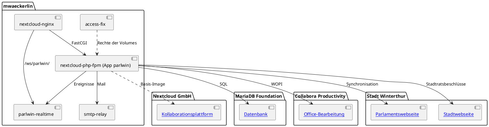
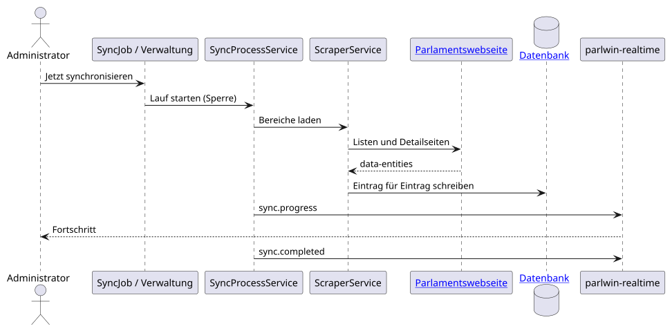
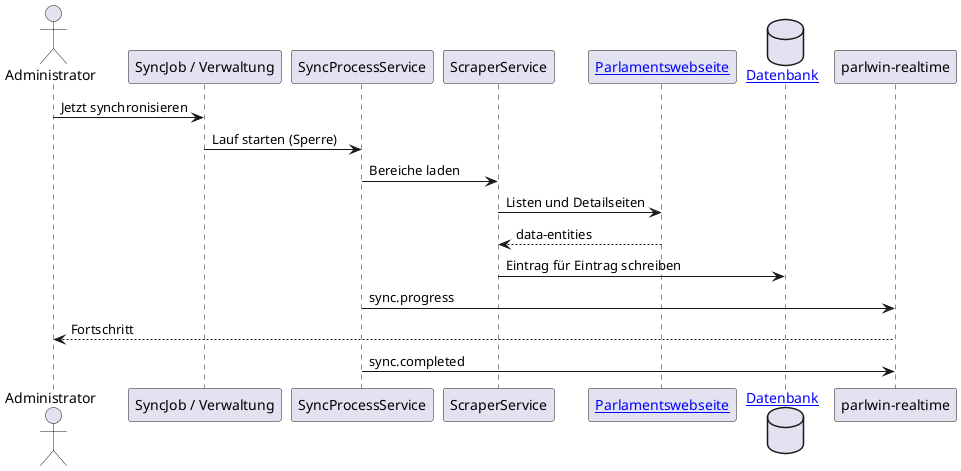

# Architektur des Parlament-Winterthur-Tools

| Angabe | Wert |
| --- | --- |
| Leser | Betreiber und Entwickler |
| Gegenstand | Die App `parlwin`, ihre drei Images, die Dienste der Compose-Dateien und der Bau |
| Grundlage | `docker-compose.yml`, `example/docker-compose.yml`, die Dockerfiles, `parlwin/lib`, `parlwin/src`, `realtime-server`, [README.md](README.md), [CONTRIBUTING.md](CONTRIBUTING.md), [FEATURES.md](FEATURES.md), [TESTS.md](TESTS.md) |
| Datum | 2026-11-04 |

## 1. Einführung und Ziele

Das Werkzeug ist eine App der [Kollaborationsplattform](#kollaborationsplattform) für die Fraktionsarbeit im Stadtparlament Winterthur. Es übernimmt die öffentlichen Daten der [Parlamentswebseite](#parlamentswebseite) und legt daneben ab, was nur die Fraktion sieht: Notizen, Zuständigkeiten, Beschlüsse, Voten und Budgetanträge. Was ein Mitglied über den Parlamentsbetrieb wissen muss, steht in [PARLAMENTSBETRIEB.md](PARLAMENTSBETRIEB.md).

### 1.1 Anforderungen

Ein Mitglied meldet sich an der Installation der Fraktion an und arbeitet in den Ansichten der Seitenleiste; der Administrator stellt die Fraktion ein und startet die Synchronisation. Jede Funktion steht mit ihrer Nummer in [FEATURES.md](FEATURES.md).

PlantUML-Quelle

### 1.2 Qualitätsziele

| Ziel | Bedeutung | Funktion |
| --- | --- | --- |
| Aktuelle Daten | die Daten der [Parlamentswebseite](#parlamentswebseite) werden nach Zeitplan übernommen, nichts geht verloren | F1, F2, F3 |
| Gemeinsame Arbeit | jede Änderung erscheint ohne Neuladen in jedem offenen Fenster | F53, F54, F147, F150 |
| Bedienung wie die Kollaborationsplattform | Aussehen und Bedienung wie die Standard-Apps der [Kollaborationsplattform](#kollaborationsplattform) | F5 |
| Gehärtete Images | die ausgelieferten Images haben weder Shell noch eine zweite Skriptsprache neben ihrer eigenen Laufzeit | `tests/image-contract.sh` |
| Erreichbarkeit | eine bestehende Auslieferung bleibt nach jedem Neustart von aussen erreichbar | F142 |

### 1.3 Beteiligte

| Rolle | Erwartung |
| --- | --- |
| Fraktionsmitglied | findet Geschäfte, Sitzungen und Budget aktuell vor und arbeitet mit den anderen gleichzeitig daran |
| Fraktionspräsident und Protokollführer | führen die Fraktionssitzung und halten Beschlüsse fest |
| Administrator | stellt Fraktion, Gruppe, Zeitplan und Kürzel ein |
| Betreiber | setzt den Stack mit Umgebungsvariablen und Secrets auf |
| Entwickler | findet jede Regel in [CONTRIBUTING.md](CONTRIBUTING.md) und jeden Test in [TESTS.md](TESTS.md) |

## 2. Randbedingungen

- Die App läuft in der [Kollaborationsplattform](#kollaborationsplattform) und folgt deren Oberfläche und Komponenten 1:1 ([CONTRIBUTING.md](CONTRIBUTING.md), Anforderung 9).
- Die ausgelieferten Images bauen auf `mwaeckerlin/nextcloud:php-fpm` und `mwaeckerlin/nextcloud:nginx`, diese auf `mwaeckerlin/php-fpm` und `mwaeckerlin/nginx`, alle ohne feste Version; der Echtzeit-Dienst baut auf `mwaeckerlin/nodejs`.
- Kein ausgeliefertes Image enthält eine Shell; was die App startet, läuft in der [Programmiersprache des Servers](#programmiersprache-des-servers).
- Kein Container bekommt ein Verzeichnis des Rechners zu sehen; Daten liegen in benannten Volumes.
- Einstellungen des Betreibers sind Umgebungsvariablen mit Standard, Einstellungen der Fraktion stehen in der Verwaltung der App.
- Dokumentation, Kommentare und Testnamen sind deutsch, Bezeichner der Fachsprache bleiben deutsch (`Geschaeft`, `Vorstoss`, `Traktandum`).

## 3. Kontextabgrenzung

### 3.1 Fachlicher Kontext

PlantUML-Quelle

### 3.2 Technischer Kontext

| Partner | Schnittstelle | Richtung |
| --- | --- | --- |
| Browser | HTTP auf Port `NEXTCLOUD_HTTP_PORT` (Standard 29824) aller Adressen des Rechners oder der Adresse `BIND_ADDRESS`, in der Auslieferung HTTPS über den [vorgelagerten Proxy](#vorgelagerter-proxy) auf 80 und 443; WebSocket unter `/ws/parlwin/` | herein |
| [Parlamentswebseite](#parlamentswebseite) | HTML mit JSON im Attribut `data-entities`, Detailseiten `/_rte/information/{id}`, PDF; Adresse `PARLWIN_QUELLE_BASE_URL` | hinaus |
| [Stadtwebseite](#stadtwebseite) | HTML der Liste `/stadtratsbeschluesse?page=<n>`, Detailseiten `/stadtratsbeschluesse/<datum>/<nummer>`, PDF unter `/download/resolution-document/…`; Adresse `PARLWIN_STADT_BASE_URL` | hinaus |
| [Mail-Server](#mail-server) | SMTP über `mwaeckerlin/smtp-relay` | hinaus |
| [Office-Bearbeitung](#office-bearbeitung) | WOPI zwischen der [Kollaborationsplattform](#kollaborationsplattform) und der [Office-Bearbeitung](#office-bearbeitung) | beide |
| [Datenbank](#datenbank) | MySQL-Protokoll, Kennwort als Secret `nextcloud_db_password` | hinaus |

## 4. Lösungsstrategie

- Die App ist eine App der [Kollaborationsplattform](#kollaborationsplattform): Anmeldung, Gruppen, Dateien, Kalender, Aufgabenboard und Suche kommen von dort, die App fügt die Fachdaten der Fraktion hinzu.
- Die öffentlichen Daten werden von der [Parlamentswebseite](#parlamentswebseite) gelesen und in eigenen Tabellen gespeichert; was dort verschwindet, wird markiert und nie gelöscht.
- Jede wichtige Änderung wird als Ereignis an den Echtzeit-Dienst gesendet, und die anderen offenen Fenster laden nach (Abschnitt 6.3).
- Je Hauptversion der [Kollaborationsplattform](#kollaborationsplattform) gibt es einen Zweig `nc<Version>`, weil ein Upgrade keine Hauptversion auslassen darf.

## 5. Bausteinsicht

### 5.1 Stack

PlantUML-Quelle

### 5.2 Dienste

| Dienst | Image | Aufgabe | Volume |
| --- | --- | --- | --- |
| `nextcloud-nginx` | `mwaeckerlin/parliament-winterthur-tool:nginx` | der [Webserver](#webserver) am Rand, reicht die Seitenaufrufe an `nextcloud-php-fpm` und `/ws/parlwin/` an `parlwin-realtime` weiter | `apps` auf `/app/custom_apps`, nur lesend |
| `nextcloud-php-fpm` | `mwaeckerlin/parliament-winterthur-tool:php-fpm` | die [Kollaborationsplattform](#kollaborationsplattform) mit der App, aktiviert sie beim Start und ruft den Cron alle `PARLWIN_CRON_INTERVAL` Sekunden auf | `data`, `config`, `apps` |
| `parlwin-realtime` | `mwaeckerlin/parliament-winterthur-tool:realtime` | WebSocket-Verteiler auf Port 3001, prüft jede Verbindung gegen die Anmeldung der [Kollaborationsplattform](#kollaborationsplattform) | keines |
| `nextcloud-db` | `mariadb` | die [Datenbank](#datenbank) | `db` auf `/var/lib/mysql` |
| `collabora` | `collabora/code` | die [Office-Bearbeitung](#office-bearbeitung) | keines |
| `smtp-relay` | `mwaeckerlin/smtp-relay`, in der Entwicklung `mwaeckerlin/fake-smtp` | reicht Mails an den [Mail-Server](#mail-server) weiter | in der Entwicklung `mails` |
| `access-fix` | `mwaeckerlin/allow-write-access` | gibt die Volumes beim Start dem Benutzer der [Kollaborationsplattform](#kollaborationsplattform) | `data`, `config`, `apps` |
| `traefik` | `parlwin-traefik`, nur in `example/` | der [vorgelagerte Proxy](#vorgelagerter-proxy) mit eingebauter Weiterleitung und Zertifikaten | `traefik-letsencrypt` |

### 5.3 App `parlwin`

| Verzeichnis | Inhalt |
| --- | --- |
| `parlwin/lib/Controller` | die HTTP-Schnittstelle der Oberfläche unter `/apps/parlwin/…` |
| `parlwin/lib/Service` | die Fachlogik: Synchronisation (`ScraperService`, `SyncProcessService`, `SyncLockService`), Geschäfte, Sitzungen, Vorstösse, Stadtratsbeschlüsse (`StadtratsbeschlussService`), Notizen, Budget (`BudgetBuchParser`, `BudgetImportService`), Dokumente, Ereignisse (`EreignisService`, `RealtimePublisherService`) |
| `parlwin/lib/Db` und `parlwin/lib/Migration` | die Tabellen `pw_…` und ihre Migrationen |
| `parlwin/lib/BackgroundJob` | Synchronisation nach Zeitplan, Lesen der Dokumente, Neueinlesen der Budgetbücher, Verknüpfung der Kommissionen |
| `parlwin/lib/Command` | die Befehle `occ parlwin:sync`, `parlwin:sync:cancel`, `parlwin:budget-reimport`, `parlwin:dokumente-lesen`, `parlwin:migrationen-pruefen` |
| `parlwin/src/js` | die Oberfläche im [Oberflächen-Framework](#oberflaechen-framework) mit den Komponenten der [Kollaborationsplattform](#kollaborationsplattform) |
| `realtime-server/server.js` | der WebSocket-Verteiler |
| `docker/` | Bootstrap und Watcher in der [Programmiersprache des Servers](#programmiersprache-des-servers), die Einstellungen des [Webservers](#webserver), die Hilfsbibliothek für die Umwandlung der Zeichensätze |

## 6. Laufzeitsicht

### 6.1 Synchronisation

PlantUML-Quelle

Systemweit läuft immer nur ein Lauf; ein zweiter Start hängt sich an den laufenden an. Ein abgebrochener Lauf setzt beim nächsten Start in jedem Bereich der [Parlamentswebseite](#parlamentswebseite) dort fort, wo er stehen blieb; die Stadtratsbeschlüsse liest er von vorn. Antwortet die [Stadtwebseite](#stadtwebseite) nicht, endet nur der Bereich der Stadtratsbeschlüsse: Der Lauf weist danach die Kommissionsmitglieder als Zuständige zu, sendet `sync.completed` und schreibt seine Zusammenfassung ins Ereignis-Protokoll.

### 6.2 Budgetbuch einlesen

Der Hintergrundauftrag `SyncJob` liest das neueste Budgetjahr ein, sobald seine Weisung vorliegt und das Jahr noch fehlt; ältere Jahre liest der Import von Hand ein. Er holt die Budgetbücher als PDF, `BudgetBuchParser` liest Produktegruppen, Investitionen und Kennzahlen, und `BudgetImportService` ersetzt den Stand des Jahres erst, wenn das Ergebnis plausibel ist; die Anträge der Fraktion bleiben stehen. Steigt die Fassung des Parsers, liest der Hintergrundauftrag `BudgetNeuEinlesenJob` die bereits gelesenen Jahre neu, stündlich eines.

### 6.3 Gemeinsam arbeiten

Nach jeder wichtigen Änderung sendet `RealtimePublisherService` ein Ereignis an `http://parlwin-realtime:3001/publish`; der Verteiler gibt es an jedes angemeldete Fenster weiter, und die Oberfläche lädt nur die geänderten Einträge nach (F147, F150); das Fenster, das gespeichert hat, lädt nichts. Die ganze Liste der Geschäfte lädt sie bei `fraktionssitzung.updated` und bei einem `sync.completed`, `sync.cancelled` oder `sync.failed` ohne `geschaeftIds`.

## 7. Verteilungssicht

### 7.1 Entwicklung

`npm start` startet `docker-compose.yml` mit allen Diensten auf einem Rechner in der [Container-Engine](#container-engine) und baut die drei Images aus dem Quelltext. Die Netze verbinden je zwei Dienste.

### 7.2 Auslieferung

`example/docker-compose.yml` zieht die Images in der Version des Projekts (`nginx-v<Version>`) und stellt den [vorgelagerten Proxy](#vorgelagerter-proxy) davor. Auf welchen Adressen die Ports 80 und 443 erscheinen, legt Entscheidung 9.4 fest.

### 7.3 Images und Linien

Der Bau auf dem [Bau-Dienst](#bau-dienst) ruft den gemeinsamen Workflow von `mwaeckerlin/scratch` auf. Jeder Push auf `master` baut die drei Images für amd64 und arm64 und veröffentlicht sie auf der [Image-Registry](#image-registry) als `nginx`, `nginx-<JJJJMMTT>`, `nginx-v<Version>` und `nginx-v<Version>-<JJJJMMTT>`, mit dem Datum des Baus, ebenso `php-fpm` und `realtime`. Danach erzeugt `create-branches.sh` die Zweige `nc33` bis `nc35` aus diesem Commit neu, und jeder Zweig wird mit den Tags `…-nc<Version>` gebaut. Stündlich prüft der Bau, ob sich ein Basis-Image oder eine Datei geändert hat, die der Bau herunterlädt, oder ob das veröffentlichte Image sieben Tage alt ist, und baut dann neu.

### 7.4 Test

Der E2E-Lauf ergänzt den Entwicklungs-Stack um `tests/e2e/docker-compose.e2e.yml`: den Dienst `parlwin-quelle`, der gespeicherte Seiten und PDF der [Parlamentswebseite](#parlamentswebseite) und der [Stadtwebseite](#stadtwebseite) ausliefert, und den Dienst `playwright` mit dem [Browser-Test](#browser-test). Der volle Testlauf baut daraus den Stack `parlwin_e2e_chromium` für den ersten [Browser](#browser) und die Tests am Telefon und, wenn der Speicher des Rechners reicht, einen zweiten Stack `parlwin_e2e_firefox` für den zweiten Browser, und hält sie über alle Phasen des Laufs; sonst läuft auch der zweite Browser in `parlwin_e2e_chromium`. Die Tests mit dem [Testwerkzeug des Servers](#testwerkzeug-des-servers) laufen im Image aus `Dockerfile.php-test`, mit derselben Fassung der [Programmiersprache des Servers](#programmiersprache-des-servers) wie die Anwendung.

## 8. Querschnittliche Konzepte

### 8.1 Gehärtete Images

Die ausgelieferten Images haben weder eine Shell noch eine Sammlung von Kommandozeilenwerkzeugen noch eine zweite Skriptsprache; Bootstrap, Watcher und Hintergrundprozesse sind in der [Programmiersprache des Servers](#programmiersprache-des-servers) geschrieben. `tests/image-contract.sh` prüft das am gebauten Image.

### 8.2 Einstellungen

Was der Betreiber einstellt, ist eine Umgebungsvariable mit Standard (`PARLWIN_PHP_MEMORY_LIMIT`, `PARLWIN_DOKUMENT_…`, `PARLWIN_SYNC_…`, `BIND_ADDRESS`); was die Fraktion einstellt, steht in der Verwaltung der App (Fraktion, Gruppe, Zeitplan, Kürzel, Typen für eigene Geschäfte).

### 8.3 Aufbewahrung der Daten

Die Synchronisation löscht keinen Eintrag; was auf der [Parlamentswebseite](#parlamentswebseite) verschwindet, wird als gelöscht markiert. Jede Änderung der Fraktion steht in der Aktionszeitleiste oder im Versionsverlauf der Notiz.

### 8.4 Gespeicherter Text

Formatierter Text wird über die Positivliste von `Service\HtmlSanitizer` ausgegeben.

### 8.5 Tests

`npm test` startet `tests/regression.mjs`. Der Lauf ruft jede Gruppe aus `tests/run-all.sh` ausser `lint` auf, weil ESLint im Projekt keine Konfiguration hat; `tests/run-all.sh lint` ruft ihn einzeln auf. Zu den Gruppen gehören die Tests mit dem [Testwerkzeug des Servers](#testwerkzeug-des-servers) und dem [Testwerkzeug der Oberfläche](#testwerkzeug-der-oberflaeche), die Live-Tests und die Prüfung der gebauten Images (`tests/image-contract.sh`). Die E2E-Tests führt er mit dem [Browser-Test](#browser-test) in allen drei [Browsern](#browser) aus, in einem oder zwei Stacks (Abschnitt 7.4). Jeder Test steht im Journal `tests/.regression/journal.jsonl`, ein abgebrochener Lauf setzt fort, und nur eine vollständige Schlussregression gibt frei. [TESTS.md](TESTS.md) ordnet jeden Test seiner Funktion zu.

## 9. Architekturentscheidungen

### 9.1 Daten aus `data-entities`

Die [Parlamentswebseite](#parlamentswebseite) führt ihre Listen als JSON im Attribut `data-entities`; die App liest es dort, statt die Darstellung zu zerlegen.

### 9.2 Linien je Hauptversion

Die [Kollaborationsplattform](#kollaborationsplattform) lässt beim Upgrade keine Hauptversion aus und verweigert ein Image, das eine Hauptversion überspringt. Deshalb trägt jede Hauptversion ab 33 einen Zweig und eigene Tags.

### 9.3 Quelle im Test

Im E2E-Lauf liefert der Dienst `parlwin-quelle` die gespeicherten Seiten und PDF der [Parlamentswebseite](#parlamentswebseite) und der [Stadtwebseite](#stadtwebseite) aus. So hängt der Lauf nicht an der Erreichbarkeit und der Antwortzeit fremder Webseiten, und jeder Lauf arbeitet mit denselben Daten.

### 9.4 Ports auf allen Adressen

Ohne `BIND_ADDRESS` erscheinen die Ports 80 und 443 der Auslieferung und der Port 29824 des Entwicklungs-Stacks auf allen Adressen, IPv4 und IPv6. So bleibt eine bestehende Auslieferung nach jedem Neustart von aussen erreichbar. Wer die Ports auf eine Adresse beschränken will, setzt `BIND_ADDRESS`.

## 10. Qualitätsanforderungen

### 10.1 Szenarien

| Szenario | Erwartung | Test |
| --- | --- | --- |
| Ein Eintrag verschwindet von der Webseite | er bleibt erhalten und ist als gelöscht markiert | [Testwerkzeug des Servers](#testwerkzeug-des-servers), E2E |
| Zwei Benutzer starten die Synchronisation | es läuft ein Lauf, beide sehen seinen Fortschritt | E2E |
| Ein Image wird gebaut | es enthält keine Shell | `tests/image-contract.sh` |
| Ein Port wird ohne das Präfix `BIND_ADDRESS` veröffentlicht | der Test schlägt fehl | `parlwin/src/js/tests/compose-ports.test.js` |

## 11. Risiken und technische Schulden

### 11.1 Risiken

- Ändert die [Parlamentswebseite](#parlamentswebseite) ihren Aufbau, scheitert die Synchronisation; die Live-Tests fragen die Webseite in jedem Bau mit acht Anfragen ab.
- Der Volltext eines Dokuments mit Tabellen zieht Zellen zusammen, und die Suche über den Inhalt findet solche Stellen nicht ([TODO.md](TODO.md)).

### 11.2 Technische Schulden

- Der E2E-Teil läuft im Bau auf dem [Bau-Dienst](#bau-dienst) nicht mit (`PARLWIN_TESTS_OHNE_E2E=1`), nur auf dem Rechner.
- Die [Image-Registry](#image-registry) baut die Images zusätzlich über ihre eigenen Build-Regeln und schreibt dieselben Tags.

## 12. Glossar

### 12.1 Begriffe

| Begriff | Bedeutung |
| --- | --- |
| Geschäft | ein Gegenstand des Parlaments, von der Webseite oder von der Fraktion selbst angelegt |
| Vorstoss | ein Instrument eines Mitglieds, etwa Motion, Postulat, Interpellation |
| Traktandum | ein Punkt auf der Tagesordnung einer Sitzung |
| Linie | die Images für eine Hauptversion der [Kollaborationsplattform](#kollaborationsplattform), Zweig `nc<Version>` |
| Tag | der Name, unter dem die [Image-Registry](#image-registry) eine Fassung eines Images führt, etwa `php-fpm-nc35-v1.8.18` |

### 12.2 Logische Bezeichnungen

<table>
<thead><tr><th>Logische Bezeichnung</th><th>Beschreibung</th><th>Firma in Grossbritannien</th><th>Firma in der Schweiz</th></tr></thead>
<tbody>
<tr><td>Kollaborationsplattform</td><td>die Plattform, in der die App läuft, mit Anmeldung, Gruppen, Dateien, Kalender, Aufgabenboard und Suche; Images <code>mwaeckerlin/nextcloud:*</code></td><td colspan="2">Nextcloud GmbH (Nextcloud)</td></tr>
<tr><td>Parlamentswebseite</td><td>die öffentliche Webseite des Stadtparlaments, <code>https://parlament.winterthur.ch</code>, die Quelle der Geschäfte, Sitzungen, Mitglieder, Kommissionen und Fraktionen</td><td>—</td><td>Stadt Winterthur</td></tr>
<tr><td>Stadtwebseite</td><td>die öffentliche Webseite der Stadt, <code>https://stadt.winterthur.ch</code>, die Quelle der Stadtratsbeschlüsse samt ihren Dokumenten</td><td>—</td><td>Stadt Winterthur</td></tr>
<tr><td>Datenbank</td><td>die relationale Datenbank der Kollaborationsplattform und der App, selbst betrieben</td><td colspan="2">MariaDB Foundation (MariaDB)</td></tr>
<tr><td>Office-Bearbeitung</td><td>die Bearbeitung von Dokumenten im Browser, selbst betrieben</td><td colspan="2">Collabora Productivity (Collabora Online)</td></tr>
<tr><td>Mail-Server</td><td>der Server, an den <code>mwaeckerlin/smtp-relay</code> die Mails der Kollaborationsplattform weitergibt; der Betreiber wählt ihn</td><td>—</td><td>—</td></tr>
<tr><td>Webserver</td><td>der Webserver im Image <code>nginx</code>, der statische Dateien ausliefert und die Anfragen an die Programmiersprache des Servers und an den WebSocket-Verteiler weiterreicht</td><td colspan="2">F5, Inc. (nginx)</td></tr>
<tr><td>Programmiersprache des Servers</td><td>die Sprache und Laufzeit der Kollaborationsplattform und der App im Image <code>php-fpm</code>, auch für Bootstrap, Watcher und die Testsuiten</td><td colspan="2">The PHP Group (PHP)</td></tr>
<tr><td>Oberflächen-Framework</td><td>das JavaScript-Framework der Oberfläche, dasselbe wie in den Apps der Kollaborationsplattform</td><td colspan="2">Open-Source-Projekt ohne Firma (Vue)</td></tr>
<tr><td>Testwerkzeug des Servers</td><td>das Werkzeug der Tests der Klassen in <code>parlwin/lib</code></td><td colspan="2">Sebastian Bergmann (PHPUnit)</td></tr>
<tr><td>Testwerkzeug der Oberfläche</td><td>das Werkzeug der Tests der Module in <code>parlwin/src/js</code></td><td colspan="2">VoidZero Inc. (Vitest)</td></tr>
<tr><td>Browser-Test</td><td>das Werkzeug, das die E2E-Tests in einem echten Browser ausführt</td><td colspan="2">Microsoft Corporation (Playwright)</td></tr>
<tr><td>Browser</td><td>die drei Browser, in denen die E2E-Tests laufen, die Tests am Telefon mit dem Gerät «iPhone 13»</td><td colspan="2">Google LLC (Chromium), Mozilla Corporation (Firefox), Apple Inc. (WebKit)</td></tr>
<tr><td>Vorgelagerter Proxy</td><td>der Reverse-Proxy der Auslieferung mit den Zertifikaten</td><td colspan="2">Traefik Labs (Traefik), Internet Security Research Group (Let's Encrypt)</td></tr>
<tr><td>Image-Registry</td><td>die Registry, die die veröffentlichten Images ausliefert</td><td colspan="2">Docker, Inc. (Docker Hub)</td></tr>
<tr><td>Container-Engine</td><td>die Engine mit Compose, die den Stack und die Test-Stacks ausführt</td><td colspan="2">Docker, Inc. (Docker Engine)</td></tr>
<tr><td>Bau-Dienst</td><td>der Dienst, der den Workflow ausführt, der die Images baut, prüft und veröffentlicht</td><td colspan="2">GitHub, Inc. (GitHub Actions)</td></tr>
</tbody>
</table>
